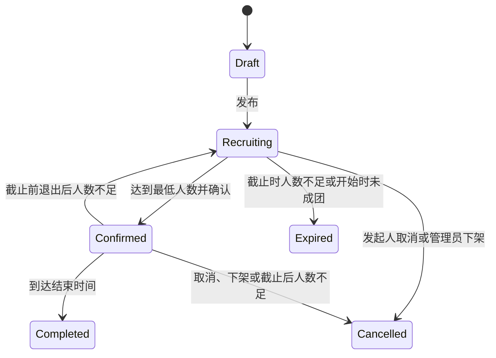

# 拼好搭子：校园临时组队平台设计方案

版本：讨论稿 v0.1，2026-10-24。用户已选择这一方向并要求展开设计，尚未要求开始编码。以下容量、规则、页面与视觉方案均为设计建议，可以继续调整，不代表课程额外要求。

## 产品定位

一句话：把“想做一件事，还差几个人”变成一场能报名、能成团、能完成的小活动。

暂定名称“拼好搭子”，副标题“一个人想做的事，拼几个人一起做”。产品面向校园中的运动、吃饭、自习、兴趣活动等需求。用户因一个具体活动组成临时小队，产品主线是活动与组队。

典型需求：今晚食堂约饭；周末羽毛球缺两人；每周口语练习；找人一起逛校园展览。第一版以单校区为范围，地点使用校内片区和文字地点，不依赖地图定位。

## 用户与权限

| 身份 | 能做的事 |
| --- | --- |
| 访客 | 浏览已发布活动、分类和公开资料；操作收藏、加入或发布时进入登录页 |
| 注册用户 | 编辑个人资料、兴趣标签，发布活动，加入/候补/退出其他活动，收藏，查看自己的通知 |
| 活动发起人 | 作为该活动的一名成员，维护草稿与活动信息，查看成员，确认成团，发公告，取消活动 |
| 已加入成员 | 查看本活动小队工作台，参与留言和签到，按规则退出与评价 |
| 候补成员 | 查看自己的候补顺序与报名状态；获得名额后才能进入完整小队工作台 |
| 管理员 | 处理举报、下架活动、限制账号，并记录理由与操作历史 |

发起人是用户在某场活动中的关系身份，不增加独立的全局账户角色。全局角色仅 User/Admin。管理员权限不能由注册请求选择，也不能由前端按钮是否可见决定。

## 十个页面

按十种主要页面模板设计：登录/注册采用同页切换，创建/编辑共用编辑器，评价与举报在相关页面弹窗完成。

| 编号 | 页面与路由 | 页面内容 | 主要后端行为 |
| --- | --- | --- | --- |
| 1 | 登录注册 `/auth` | 账号、密码、注册切换、错误提示；成功后返回原目标页面 | 注册、登录、会话验证 |
| 2 | 搭子广场 `/discover` | 搜索、运动/吃饭/学习/兴趣分类、日期与校区片区筛选、活动卡片、推荐理由 | 分页查询已发布活动、读取收藏状态 |
| 3 | 活动详情 `/activities/:id` | 活动介绍、时间、地点概况、人数、发起人资料、加入/候补/收藏；本人报名状态 | 读取详情、加入、候补、退出、收藏、举报 |
| 4 | 发布/编辑 `/activities/new`、`/activities/:id/edit` | 标题、分类、人数、时间、集合点、活动要求、草稿、发布前检查与预览 | 保存草稿、更新、发布；检查归属、输入及状态 |
| 5 | 我加入的 `/my/joins` | 已加入、候补、已结束、已退出筛选，活动时间轴、退出操作与工作台入口 | 查询当前用户的参与记录、退出 |
| 6 | 我发起的 `/my/hosted` | 草稿、招募、已成团、已结束、已取消列表；编辑、查看小队、确认与取消入口 | 查询本人活动与人数，确认成团、取消 |
| 7 | 小队工作台 `/activities/:id/team` | 成员名单、集合说明、发起人公告、成员留言、签到、完成后评价入口 | 校验成员身份、读写小队消息、签到、评价 |
| 8 | 消息中心 `/notifications` | 获得名额、候补转正、成团、取消、时间调整、举报处理结果；未读筛选 | 分页读取本人通知、标为已读 |
| 9 | 个人中心 `/users/:id` | 头像、昵称、介绍、兴趣、参与记录摘要、收到的评价；本人可编辑并查看收藏页签 | 读公开资料、修改本人资料、查询本人收藏 |
| 10 | 管理控制台 `/admin` | 举报队列、活动与账号管理、处理记录、小型运营概况 | 管理员校验、处理举报、下架、限制账号、审计 |

详情页与小队工作台的分工：详情页负责决定是否加入；工作台负责已加入后的集合、交流与参与。后台只展示管理员确实能执行的操作。

## 关键页面布局

### 搭子广场

顶部为品牌、广场/我的活动/消息/个人中心入口与发布按钮。主内容依次是搜索区、分类/日期/片区筛选、活动列表。卡片突出标题、开始时间、片区、“3/4 人”和招募状态；兴趣标签及一句说明作为辅助信息。手机端筛选折叠，发布入口保持易于找到。

首版推荐以兴趣标签、所选片区和可报名时间筛选/排序，并显示“与你的羽毛球兴趣相符”等理由。未登录或未设置兴趣时按即将开始、最新发布等明确规则排序。不承诺 AI 自动理解或匹配。

### 活动详情

左侧/上方是介绍、规则与发起人；右侧/下方是报名区域。按钮随当前用户和活动状态变化，例如“我要上车”“加入候补”“已加入，进入小队”“已结束”。同时保留清楚的正式状态文字。首版所有参与者看到相同的公共活动要求，不按性别等不必要维度筛人。

公共详情展示校内片区与地点概况；详细集合说明放在工作台。个人联系方式不作为公开必填项。

### 小队工作台

入口清楚呈现 ActivitySummary、MemberPanel、MeetingPanel、TeamDiscussionPanel、CheckInPanel、ReviewPanel 等业务区域。发起人的管理操作置于明确区域，普通成员只看到自己可执行的行为。

留言区首版采用普通站内消息和刷新/适度轮询，发起人公告置顶。没有即时聊天在线状态、私信附件或消息已读回执的承诺。

## 业务规则

### 人数、加入与候补

- 总人数建议 2–12 人，包含发起人；最少成团人数在 2 到总人数之间。发布时自动为发起人创建一条已加入记录。
- 首版采用直接加入，有名额即加入，无名额则可候补；人工审批和邀请制留待扩展。
- 同一个用户在同一活动只有一条参与记录，不能重复占座。发起人不能再次报名，也不能把自己退出后留下无主活动。
- 候补按本次有效排队时间、记录 ID 稳定排序。退出候补再加入，需要重新排队。
- 报名截止时间不晚于开始时间，开始时间早于结束时间。超过截止时间禁止新增报名和候补。
- 释放名额与候补转正必须在同一事务内完成；转正者收到通知。截止前才自动递补。
- 已成团活动在报名截止前仍可补充成员，最多达到容量。成团后显示“已成团，还可加入”，满员显示“已成团，人员已满”。
- 活动开始前可退出：截止前先自动递补；若已成团活动仍低于最低人数，恢复招募并通知所有已加入成员。截止后不再递补，已成团活动若因退出低于最低人数，则取消并通知成员。活动开始后关闭普通退出入口。
- 活动一旦存在发起人以外的有效已加入或候补成员，人数、最低人数、时间、分类和集合地点等关键字段锁定；发起人可补充公告，重大变更需取消后重新发布，避免用户在不知情时接受不同活动。
- 发起人取消活动要填写理由。不能硬删除已有成员的活动记录；取消是可追踪的状态变更。

### 成团与结束

发起人在达到最低人数且开始时间尚未到来时可确认成团。开始时间到来仍未确认的活动失效。确认成团的活动到结束时间自动完成；签到只在已成团活动的开始至结束时间区间开放。签到是站内参与记录，不声称具有现实定位证明能力。

活动状态使用封闭枚举：Draft、Recruiting、Confirmed、Completed、Cancelled、Expired。满员和“进行中”是人数/时间的派生展示，不单独保存为互相冲突的主状态。

报名截止到来时，Recruiting 且人数不足的活动变为 Expired；人数已够则保留到开始前供发起人确认，界面显示“待确认成团”。开始时间到来时所有仍 Recruiting 的活动变为 Expired。

系统模块可用一个轻量定时任务处理到期状态，业务写接口仍再次校验服务端时间。状态与通知写入同一事务，并以唯一事件键防止定时任务重跑导致重复通知。

Draft 由本人可直接删除；终态不再接受报名、签到和普通编辑。已完成活动的举报处理以隐藏展示为主，保留历史完成状态和处理记录。

### 评价与管理

- 第一版评价限定同场活动已完成且双方都有签到记录的不同用户，一对一每场最多一条，可附“准时”“好沟通”等具体标签。
- 展示参与次数、签到记录和收到的评价；新用户显示“新搭子”。第一版不引入来源不明的综合信誉分或自动处罚。
- 公开资料只展示昵称、头像、兴趣和获准公开的活动/评价摘要；私人报名记录、收藏、通知、账号字段只允许本人查看。
- 举报需指定活动或评价并填写理由。管理员可驳回、隐藏内容、取消未完成活动或限制账号，必须记录处理人、时间和理由。
- 普通用户不能改他人的活动、报名、通知或资料。隐藏活动仅允许相关成员及管理员查看保留记录，并明确显示原因。
- 受限制账号禁止新登录及新的发布、报名、留言、评价；服务端会话校验重新检查账号状态。管理员处理限制时同步取消其尚未开始的自建活动并通知成员；其尚未开始的报名通过相同退出/递补规则释放名额，保留审计记录。涉及多场活动时按稳定 ID 顺序处理，降低锁冲突。

## 一个完整的演示故事

小林发起“周六下午羽毛球，4 人局”，最低成团人数为 4，发起人占 1 个名额。小周、小李、小陈依次加入后人数为 4/4，小赵加入候补。

小陈在截止前退出，系统同一事务内把小赵转为已加入。小林确认成团，所有成员在消息中心收到通知。成员进入小队工作台查看集合说明、留言，并在活动时间内签到。到结束时间活动完成，成员可以互评。各自的个人中心增加参与记录，刷新或重新登录后仍然存在。

这条故事覆盖真实数据库写入、权限校验、容量约束、候补、状态变化、消息、签到和评价。管理员另以一条演示举报展示处理闭环。

## 数据结构与模块归属

按业务划分模块，部署为一个后端应用即可。每个模块拥有自己的表，公开封装表方法可跨服务调用。

| 模块 | 表/主要数据 | 职责 |
| --- | --- | --- |
| users | users、user_sessions、user_interests | 账号、口令哈希、角色、账号状态、令牌、个人资料与兴趣 |
| activities | activities、activity_favorites | 活动内容、时间、人数限制、状态、公开可见性、收藏 |
| teams | activity_participations、team_messages | 报名、候补顺序、成员身份、签到、小队公告/留言 |
| feedback | reviews、reports、moderation_logs | 活动互评、举报、管理处理与操作历史 |
| notifications | notifications | 本人站内通知、业务事件去重键与已读时间 |
| system | 配置、连接、事务、共享路由、启动及到期任务 | 共享基础设施，业务表 SQL 仍由各业务模块维护 |

关键字段示例：

- Activity：ActivityId、ownerId、title、category、description、campusArea、publicLocation、meetingInstructions、minimumMembers、capacity、registrationDeadline、startsAt、endsAt、status、visibility、createdAt、updatedAt。
- Participation：ParticipationId、activityId、userId、role（Host/Member）、status（Accepted/Waitlisted/Withdrawn）、queuedAt、checkedInAt、createdAt、updatedAt。发起人关系也存此表，并设置 `(activityId,userId)` 唯一约束。
- TeamMessage：messageId、activityId、authorId、kind（Discussion/Announcement）、body、createdAt。只有发起人能发布公告。
- Review：reviewId、activityId、reviewerId、revieweeId、rating、tags、body、visibility、createdAt；同场同方向评价唯一。
- Notification：notificationId、recipientId、kind、relatedActivityId、eventKey、body、createdAt、readAt；收件人和事件键唯一，避免重复投递。
- Report：reportId、reporterId、targetType、targetId、reason、status、resolution、handledBy、handledAt。

满员状态与当前人数由有效 Participation 记录计算，第一版不额外维护容易失去同步的人数缓存。用户资料响应不含口令哈希、盐和会话令牌。

## 关键 API 与事务

| 模块 | 代表性操作（名称示意） |
| --- | --- |
| users | RegisterUser、LoginUser、GetCurrentUser、UpdateProfile、GetPublicProfile、ResolveUserToken（内部）、RequireAdmin（内部）、RestrictUser（内部） |
| activities | ListActivities、GetActivity、SaveActivityDraft、PublishActivity、ConfirmActivity、CancelActivity、SetActivityFavorite、ListHostedActivities、ListFavoriteActivities、AdvanceDueActivities（内部） |
| teams | JoinActivity、WithdrawParticipation、ListMyParticipations、GetTeamWorkspace、PostTeamMessage、CheckIn |
| feedback | CreateReview、ListUserReviews、CreateReport、ListReports、ResolveReport、GetAdminOverview、ListModerationLogs |
| notifications | ListMyNotifications、MarkNotificationRead、CreateNotification（内部） |

以上为业务操作索引，正式文件遵守 `XxxAPIMessage.scala`，前端 `XxxAPI.ts`。面向前端的 API 才注册路由并生成前端调用文件。

“抢最后一个名额”的处理方式：JoinActivityAPIMessage 使用当前可信 userId，锁定活动行，检查活动可报名时间与账号状态，再检查本人参与记录、有效人数，决定加入或候补，写入记录和通知并提交事务。第二个请求取得锁后重新读取人数，不能根据前端显示的剩余名额判断。

同一活动的发布、加入、退出、确认、签到、取消和到期变更采用一致的活动行锁顺序，操作中的跨服务 API/Table 共用 connection。通知失败导致该业务事务回滚；重试依赖唯一记录/事件键保证不重复占座或发通知。

路由边界解析外部 userToken，验证后生成可信 userId；业务消息输入接收可信身份。权限判断放在后端，不能依靠隐藏按钮。公开详情响应与私有工作台响应分别定义，私有集合说明不能随公开接口一并泄露。

## 课程规范的具体落实

- 前端 React + TypeScript + Vite，样式用 Tailwind，必要的跨页面状态用私有 Zustand store 及公开 hooks/get/set 接口。
- 后端 Scala 3 + Cats Effect IO + http4s + Circe，PostgreSQL 持久化。版本在正式实施时按兼容性确定。
- 后端服务目录只按需要使用 api/objects/routes/tables/utils；系统后台任务可归 services/system/utils，启动组合和路由归 system 明确职责文件，不增加隐含转发层。
- 一对象一文件；领域对象保持纯粹，API 响应放 objects/apiTypes；有限状态使用枚举和 TS 联合类型。
- 每 API 独立 `final case class`，业务输入放构造参数，`plan(connection): IO[Response]`；IO 显式组合，API 可调用公开 API plan 或公开 Table def。
- 每表独立目录与 Table/Initializer 两文件；私有 Sql 与公开执行 def 相邻，返回 IO[T]；utils 函数限定在所属服务。
- 页面使用 index.tsx + 就近 hooks/objects/functions/components。活动详情和工作台显式表达 loading/ready/empty/error 与提交状态。
- 前后端统一由类型/名称规则推导 API 路由，构建产物需验证命名稳定性；通用发送、令牌、错误和命名机制按职责独立。
- 设计、报告和其他文档产物放 docs，不混入源码。

## 视觉与文案建议

方向：校园生活杂志与拼团票券的结合。暖白背景、深灰正文、青柠绿主操作，少量紫色表示候补或个人标签；容量用“3/4 人”与明确状态文字，不能只依赖颜色。优先保证阅读与操作清楚，再增加活动封面和轻量动画。

“今天拼什么”“我要上车”“加入候补”“拼齐了，准备出发”用于入口、按钮和成功提示。规则、截止时间、取消原因和错误提示采用清楚的普通文字，例如“报名已截止”“你已退出，名额已释放”。

首版头像采用内置图案，活动封面采用分类配图和用户可选预设，减少上传/存储链路；自定义上传可以后续增加。

## 首版与扩展

首版包含十种页面、登录注册、个人资料与兴趣、活动发布/查询/筛选、加入/候补/退出、确认成团/到期、工作台留言、签到、评价、收藏、站内通知、举报与管理。

后续可选：重复活动模板、日历导出、邀请制/报名审核、独立私信/即时聊天、地图、图片上传和个性化推荐。它们不是当前首版的验收条件。

## 实施顺序与验收

建议先完成用户、活动和报名的最小端到端链路，再实现候补与状态；随后补齐工作台、通知、评价与管理，最后统一视觉与演示数据。

关键验收：

1. 页面操作读写真实后端，刷新和重新登录后数据保留。
2. 两个账号同时争抢最后一个名额，只有一个取得名额；重复点击不会重复报名。
3. 截止前退出后最早候补自动转正；名额变化与通知一致。
4. 未达最低人数不能确认成团；截止/开始/结束时间规则由服务端执行。
5. 未加入者不能访问工作台和集合说明；普通用户不能修改他人的活动或访问管理员操作。
6. 取消和下架保留原因及历史，通知成员；后端错误不能留下半完成状态。
7. 完成和签到条件未满足时不能评价，重复评价受到约束。
8. 到期任务或请求重试不产生重复通知；账号限制对旧会话同样生效。
9. 已加载、空结果、请求失败、提交中和失效活动都有明确页面反馈。
10. 完成前端类型检查/检查构建、后端编译及核心业务验证，按真实改动补充必要测试。

本文件仅为方案；没有创建前端、后端或数据库，没有执行部署。
