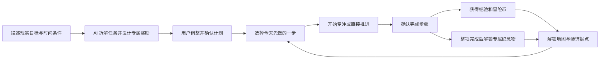

# 拖延勇者协会：任务冒险与据点养成系统

版本：讨论稿 v0.2，2026-10-24。用户已明确强调 AI 拆任务很重要，并提出由 AI 为任务生成定制奖励；本版将两项纳入首版核心功能。“拼好搭子”方案仍保留供比较，尚未要求开始编码。页面、数值、具体生成方式与视觉均可调整。

## 产品定位与使用场景

一句话：让 AI 把现实目标拆成可行动的冒险关卡，为任务设计专属纪念奖励，用每次小进展建设属于自己的勇者据点。

暂定名称“拖延勇者协会”，副标题“今天先推进一点，冒险就会继续”。核心用户是需要管理作业、复习、运动与个人计划的大学生。产品将任务管理、专注记录、成长反馈与空间装饰连接起来。

第一版以个人使用为中心；每个账号拥有独立任务、存档、余额和据点。用户的“勇者”身份是产品设定，不额外增加角色职业、战斗技能或复杂数值系统。普通账户即可完成全部主要功能；管理员界面不作为首版必须页面。

例子：用户创建“完成课程项目”主线，拆成选题、页面设计、前后端实现、检查演示四个步骤。每完成一步获得经验与冒险币，地图逐步解锁，用户用冒险币购买书桌、台灯或植物，装饰一间小木屋。

## 核心循环

任务完成以用户主动确认为准，产品不宣称能验证真实学习成果。经验和冒险币用于个人成长反馈，不兑换现实货币，也不用于比较学业能力。

## 十个页面

按十种主要页面模板设计。登录和注册共用一页；任务创建、详情和编辑使用同一工作台模板的不同模式；今日挑战放在协会大厅，徽章放在成长档案，购买确认和任务完成采用弹窗。

| 编号 | 页面与路由 | 内容与主要操作 | 主要后端职责 |
| --- | --- | --- | --- |
| 1 | 登录注册 `/auth` | 账号密码、注册切换；首次登录选择内置头像和昵称 | 注册、登录、会话验证，初始化个人进度与钱包 |
| 2 | 协会大厅 `/dashboard` | 今日任务、下一步行动、经验条、今日专注概况、每日小挑战、据点入口 | 汇总本人当日任务、成长和专注记录 |
| 3 | 任务大厅 `/quests` | 全部任务，按分类、截止日期、状态筛选；创建与归档 | 分页查询本人任务、草稿、历史及归档 |
| 4 | 任务工作台 `/quests/new`、`/quests/:id` | 输入目标与时间条件，AI 拆解/调整、专属奖励预览；确认后开始，完成步骤与复盘 | 生成任务管理、结果校验/采纳、计划版本、保存/开始任务、完成与奖励 |
| 5 | 专注营地 `/focus` | 绑定一个未完成步骤，倒计时，开始、暂停、继续、结束，查看本次记录 | 维护唯一进行中会话、记录服务端时间与专注区间 |
| 6 | 冒险地图 `/map` | 固定区域的可视化地图、解锁条件、已达成里程碑、下一站目标 | 根据经验等级计算可解锁区域与里程碑 |
| 7 | 我的据点 `/base` | 固定视角房间，摆放已购家具与已解锁任务纪念画，调整壁纸 | 合并持有物品、保存槽位配置、校验归属与奖励解锁 |
| 8 | 补给商店 `/shop` | 家具和装饰目录、价格、余额、预览、购买确认 | 检查余额、原子扣款、发放物品与购买记录 |
| 9 | 成长档案 `/growth` | 周/月任务完成、专注统计、成长时间线、任务专属奖励图鉴、个人复盘 | 按本人记录汇总统计与成就，查询奖励历史与专属纪念物 |
| 10 | 勇者资料 `/profile` | 昵称、头像、每日目标、默认专注时长、账号设置 | 修改本人资料与偏好、退出登录 |

协会大厅突出“今天做什么”，任务大厅管理“全部有哪些事”，成长档案呈现“过去推进了什么”，个人资料管理“我是谁与我的偏好”。

## 关键页面设计

### 协会大厅

核心区域依次为今日欢迎与角色、推荐先做的一步、今日任务、成长概况与据点入口。主按钮使用“先做这一小步”。系统优先显示用户主动置顶的任务，然后按已逾期、即将截止与其他活动任务排序；文字解释排序原因。

每日小挑战采用低门槛行为，如“今天完成一个步骤”“进行一次专注”。从已有任务和专注记录计算挑战进度，不创建第二套重复待办。首版挑战只提供完成印章与反馈，不额外发币。

### 任务工作台

业务区域为 GoalInputPanel、AIPlanPanel、StepList、NextActionPanel、RewardPreview、CompletionHistory 和 ReflectionPanel。新建时可手动填写任务，也可以输入目标、截止时间、每日可用时长和当前进度，由 AI 提议 1–5 个阶段；每个阶段附具体行动清单、预计时长、完成标准与前置阶段。行动清单作为步骤内部的提示与勾选项，不新增独立奖励预算。用户修改、排序、合并并确认后才成为正式任务。

每个步骤应描述一个可行动的结果，如“画出首页草图”，避免“认真学习”等难以判断完成条件的表述。预置少量作业、复习、运动模板，用户确认后才保存为自己的任务。

主线任务可以使用 Boss 形象作为进度反馈：完成步骤降低剩余进度，所有步骤完成后展示通关反馈。Boss 血条直接由步骤完成比例派生，没有独立战斗逻辑。

### 我的据点

固定视角的 2D 小木屋，插画背景叠加可替换家具。第一版提供 6 个明确槽位，例如书桌、照明、座椅、窗边、墙面和地面。用户点选槽位，选择自己已经拥有且适配的家具，保存后跨设备恢复。

首版每件商品只有一份持有记录，一件家具同时占一个槽位；同一槽位只放一件。更换家具释放旧物品的槽位，旧物品仍归用户。已解锁的任务纪念画可使用墙面槽位，与已购商品共享同一套摆放约束。默认房间自带基础地板与小床，不需要购买才能正常查看。

不设计自由移动角色、自由拖拽碰撞、3D 建模、家具合成或复杂建造材料。后续可逐步扩展。

## 成长与奖励规则

首版保留两类数值：经验用于等级和地图，冒险币用于购买家具。以下为建议数值。

| 任务档位 | 适用描述 | 整个任务经验 | 整个任务冒险币 |
| --- | --- | --- | --- |
| 小步任务 | 一次简单行动，例如整理桌面或完成短练习 | 20 | 10 |
| 普通任务 | 需要数个步骤完成的一件事 | 40 | 20 |
| 主线任务 | 一个需要分阶段推进的较大目标 | 60 | 30 |

奖励预算属于整个任务，拆成更多步骤不会增加总额。按步骤平均分配冒险币，整数余数分配到最后一步，每一步经验为该步冒险币的两倍。例如普通任务拆成四步，每步 10 经验、5 冒险币。完成全部步骤只结算最后一步奖励并标记任务完成，不再重复发整任务奖励。

任务“开始冒险”时冻结档位、步骤数量、步骤顺序、奖励分配和所选专属奖励设计；开始后仍可调整标题、说明、截止日期和未完成步骤的文字，但不能修改已完成记录或拆出新的奖励。AI 可以为未完成步骤提供更小的行动清单或时间安排建议，由用户采纳为步骤说明，不重置进度或增加奖励。首版不支持进行中任务的有奖阶段重构。

任务专属徽章/纪念画在整项任务完成时额外解锁一次，属于不可交易、不可出售的纪念物，不增加经验或货币，因此不受当日经验/金币额度耗尽的影响。放弃再恢复或重复提交不能重复解锁。

## AI 拆任务：首版核心功能

### 输入与交互

用户先提供“想完成什么”，可补充截止日期、每天可投入多少分钟、已经做了哪些、卡在哪里。模型可针对缺少且会明显改变计划的信息提出最多两个简短问题，也允许按明确标注的假设先生成草案。日期和用户当地自然日由后端提供，预计时长标为估计。

例如：“两周内完成一个十页左右的前后端课程项目，每天约一小时，选题已确定，现在不知道怎么开始。”

输出围绕现实工作：明确目标/交付物、最多五个阶段、每阶段的 1–3 条具体行动、预计分钟数、完成标准、前置阶段 ID、建议顺序与第一步。游戏化名称附在现实行动标题旁，例如“搭建后端工程（建立冒险营地）”，不能只输出幻想叙事。

后端根据可用天数与每天分钟数计算时间预算，核对模型估计与依赖结构；超出预算时显示“预计工作量大于当前可用时间”，给出减少范围或调整日期的方案，交由用户选择，不声称保证按时完成。

用户可编辑、删除/合并阶段、重新排序，或反馈“第一步太大”“这一步已经完成”“每天只有二十分钟”。生成结果先作为草案展示；只有确认采纳后写入正式任务。重新生成不覆盖已保存的手动修改，结果版本不同需要明确选择。

### 结构与校验

生成计划采用明确的响应类型：GoalSummary、PlanStageDraft、ActionChecklistItem、CompletionCriterion、EstimatedMinutes 与依赖 ID。各有意义类型独立文件，传输结构归相应 objects/apiTypes。

后端验证阶段数量、文本长度、正整数时长、截止日期、引用存在且无循环依赖、总预算与基本可执行性。模型输出作为数据处理，不执行其中的脚本、SQL、URL 指令或自定义代码。奖励数字按系统规则计算，模型只可建议档位理由。

生成异常、超时或无效结构时保留原输入与既有草案，允许重试或手动编辑；模板/手动方案必须明确标注，不能伪装成已成功调用 AI。

## AI 定制奖励：首版核心功能

### 奖励体验

AI 根据任务主题、阶段与用户选择的风格，设计一份任务完成纪念物。第一版支持 Badge（徽章）与 WallFrame（纪念画）两种可控形态，并生成名称、简短纪念文案、视觉主题、配色和图案描述。

| 现实目标 | 专属奖励示例 | 与任务的联系 |
| --- | --- | --- |
| 完成软件课程项目 | 破题之灯 | 将“从混乱到能运行”表现为点亮的灯，嵌入项目关键词 |
| 完成摄影作业 | 光影相框 | 围绕本次摄影主题生成相框图案与纪念文案 |
| 完成英语学习计划 | 旅人徽章 | 用本次学习目标与选择的旅行意象设计图案 |

这些是创意示例，不是 AI 已经生成的真实素材。用户可选择温暖手账、像素冒险等风格，首次使用时默认采用产品统一美术方向。可预览并修改名称/文案或换一个设计，满意后与任务绑定。

奖励在开始前展示，明确完成条件并以未解锁状态预览；步骤完成提供币与经验反馈，整项完成时点亮专属纪念物并进入成长图鉴。纪念画解锁后可摆在房间墙面，保留原任务名称、完成日期与纪念文案。

### 两种视觉实现

首版必须完成“AI 设计名称、故事与结构化视觉参数，系统用统一徽章/相框模板渲染”的路径，能实现内容、配色、图案与布局的任务定制。模板定制应如实标注，不称为每个像素都由图像模型生成。

同时设计独立的主线奖励插画接口：如果选定的模型服务支持图像生成且用户接受相应调用成本，可为重要主线生成一张专属插画，放进固定尺寸徽章/相框。实际模型、费用与是否首版启用尚待实施前确定，不凭空承诺某个服务可用。

固定奖励形态与摆放槽位，图像只是其中的展示资产，不允许图像模型任意引入新家具结构、碰撞逻辑或特殊能力。名称和纪念文字在图片外由网页排版，保证可读性与可编辑性。生成任务设计时即可开始准备素材，完成任务时只解锁已绑定设计，避免领奖现场长时间等待。

图片失败时保留同一奖励的模板版；任务完成与纪念物解锁不依赖外部图像服务成功。插画随后可补全，不重复解锁、不重复发币；解锁后不自动随机改变设计。

### 实际生活奖励（可选）

可以额外让 AI 根据用户自己填写的偏好和预算建议“看一集喜欢的动画”“周末安排一段休息时间”等自我奖励，由用户选择并设置条件。首版可先保存为任务附加文字清单；不自动下单、不支付，也不保证软件外的奖励已兑现。

### 边界与确认

AI 负责设计计划和奖励表达，经验、货币、物品解锁条件与持有权由后端规则确定。用户在开始前看到并确认奖励，不能让模型擅自决定充值、无限金币或改变已经完成的任务。

## AI 请求、存档与服务归属

AI 外部连接归 services/ai：公开消息承担生成业务边界，服务私有 utils 封装模型请求、提示词与解析；ai_generation_jobs 表保存异步生成请求、任务版本、状态与结构化结果。页面通过生成 API 提交并查询进度，工作台分别表达生成中、生成成功、失败、结果已过期和待确认。

提交生成先验证用户和输入，保存 Pending 请求后释放数据库连接；后台工作再调用外部服务，不长时间占用数据库事务等待模型。返回后在短事务中保存已校验结果。外部请求用 IO/Resource 组合，不在 objects 中放客户端或副作用。

请求记录含 ownerId、kind（Plan/RewardDesign/RewardArtwork）、targetQuestId（草案时可空）、inputSnapshot、inputRevision、status、result、errorCode、requestKey 和时间。仅本人可读取。相同请求键重试返回既有生成任务；改变输入再生成使用新版本。采纳时核对任务归属与输入版本，防止较慢的旧结果覆盖新编辑。

计划采纳归 quests；奖励设计、解锁与展示归 economy；ai 模块只负责生成工作流。提示词/类型定义不授予钱包或任务写入权限。服务私有工具不跨模块裸调用，使用公开 API 消息或封装 Table 方法。

模型密钥仅保存在后端；发送本次生成所需的目标、时间条件和用户选定偏好，不默认发送整份个人档案、完整历史或其他用户资料。调用设超时、有限重试、并发与用量限制；生成失败不影响已有任务与普通领奖。

建议每日最多获得 120 经验和 60 冒险币，按固定 Asia/Shanghai 自然日由服务端计算。接近上限时按剩余额度发放；达到上限后仍可完成并记录任务，显示本次奖励为 0 及原因，不延后到次日补发。上限可在讨论后调整。

同一步骤最多结算一次；重复点击、页面重试和重新打开任务都返回既有完成结果。第一版完成前给予确认，完成后的步骤不能回退领取；已开始任务可归档，之后恢复保留原奖励预算和完成记录。

等级建议每累计 100 经验提升一级：等级 = 1 + floor(累计经验 / 100)。累计经验不因消费冒险币减少。地图区域示例：起点营地（等级 1）、晨光草地（等级 2）、知识森林（等级 3）、灵感山丘（等级 5）、远望灯塔（等级 8）。地图为固定插画区域，不为每个任务动态生成地图。

## 专注与任务完成的关系

专注记录投入过程，任务完成记录用户确认的结果。用户可以直接完成步骤，也可以先进行一次或多次专注；倒计时结束不会自动完成步骤。第一版专注不额外发币或经验，避免同一行为在多处重复领取。

可选预设 10/25/45 分钟；一个用户最多有一个 Running 或 Paused 会话。绑定未完成且属于自己的任务步骤，或选择“自由专注”。切换绑定步骤需结束当前会话并另开一次。

开始、暂停、继续、结束均由后端记录时间。前端倒计时根据服务端起点显示，刷新后从后端恢复；不能通过传入任意 elapsedSeconds 获取完成状态。专注区间存储开始和结束时间，时长上限为该会话目标时长，暂停时间不计入。切换浏览器标签不暂停会话；浏览器关闭后按明确显示的计时规则继续，不能声称证明了用户持续专心。

会话可以 Completed 或 Abandoned 结束。手动提前结束保留实际记录，未达到目标不标记完成。增长统计按区间与当地自然日的重叠时长汇总，避免跨午夜将全部时间算到错误日期；客户端不控制统计结果。

## 失败、延期与重新开始

- 任务延期只改变显示提示，不扣已有经验或冒险币，也不清空房间。
- 逾期由未完成状态与服务端日期计算，不另存容易失去同步的状态。
- 可以修改截止时间、归档暂时不做的任务，并保留已经推进的步骤。
- 首版不将连续天数断掉作为惩罚条件，成长档案显示累计活跃天数、完成记录与个人变化。
- “重新出发”入口展示仍未完成的最小步骤和一条容易执行的任务模板，采用“今天先动一下”等文字，不对用户进行贬低。

任务状态为 Draft/Active/Completed/Archived，归档前状态另行保留以便恢复；步骤状态为 Todo/Completed；专注状态为 Running/Paused/Completed/Abandoned。归档任务不能继续提交完成，先恢复；已完成任务归档后恢复仍为已完成。

## 商店与装饰示例

| 商品 | 建议价格（冒险币） | 位置 |
| --- | --- | --- |
| 暖光小台灯 | 15 | 照明 |
| 窗边小盆栽 | 10 | 窗边 |
| 勇者书桌 | 25 | 书桌 |
| 星星地毯 | 20 | 地面 |
| 冒险纪念画 | 20 | 墙面 |

首版准备约 12–18 件内置商品，保证预览图、实际房间样式与物品类型一致。已拥有商品显示已拥有，重复购买请求不重复扣款。余额不足时显示还差多少币和返回任务的入口。商品目录由初始化数据提供，后续需要运营管理时再增加管理页面。

## 完整演示故事

用户注册并获得基础小木屋，输入“完成课程选题”及自己的时间条件。AI 提议“列出点子、选择方向、整理页面、写出介绍”四步，并设计“破题之灯”纪念画。用户修改草案、选择普通任务档位并确认开始，每步分配 10 经验和 5 冒险币。

用户在大厅选择第一步，启动专注计时并演示暂停、继续、刷新恢复；任务工作台中确认完成步骤，后端记录完成并发放奖励。完成三步后获得 15 冒险币，在商店购买台灯并摆进据点。第四步完成后任务通关，总计 40 经验和 20 冒险币，购买后余额为 5，同时解锁已预览的“破题之灯”纪念画并摆在墙上。成长档案展示 AI 计划、任务、奖励与专注记录。

现场演示不要求等待完整 25 分钟：可演示计时行为，并展示预先准备的专注历史。等级地图可使用已有历史进度的演示账号，不能在正式 API 中加入任意发经验的捷径。

## 后端模块与数据

模块逻辑分开，部署为一个后端应用。遵循课程 services、消息 API、IO、公开 Table def 与私有 utils 约束。

| 模块 | 表 | 职责 |
| --- | --- | --- |
| users | users、user_sessions | 账号、角色、登录、会话、昵称/头像/偏好 |
| quests | quests、quest_steps | 本人任务、截止时间、步骤、完成状态与冻结的奖励预算 |
| focus | focus_sessions、focus_segments | 专注会话、暂停/继续、有效计时区间 |
| adventure | player_progress | 累计经验、等级、地图解锁与成长汇总；等级和徽章从记录派生 |
| economy | wallets、reward_events、daily_reward_totals、store_items、player_items、reward_designs、task_rewards、room_placements | 钱包、奖励账本、商店、已购物品、AI 纪念物设计与解锁、统一据点槽位 |
| ai | ai_generation_jobs | 异步计划/奖励设计/可选插画生成，输入快照与结果版本 |
| system | 配置、连接、事务、路由与启动 | 共享基础设施，不接管业务表 SQL |

加入 AI 与专属纪念物后，初步约 16 张表。每表有独立目录、Table 和 Initializer，SQL 及行映射保持私有，业务层使用公开 IO[T] 方法。具体字段以实施时的数据设计为准。

主要对象：

- Quest：QuestId、ownerId、title、category、dueAt、rewardTier、status、statusBeforeArchive、inputRevision、adoptedPlanJobId、selectedRewardDesignId、startedAt、completedAt、reflection、createdAt、updatedAt。
- QuestStep：StepId、questId、position、title、description、actionChecklist、completionCriterion、estimatedMinutes、prerequisiteStepIds、status、plannedCoinReward、plannedExperienceReward、completedAt。创建阶段位置唯一，开始后奖励冻结。行动清单/依赖采用有类型的结构并约定序列化，不存可执行表达式。
- RewardEvent：RewardEventId、userId、sourceType、sourceId、experienceDelta、coinDelta、rewardDay、createdAt、reason；任务步骤来源键唯一，零奖励也记录结算结果。
- PlayerProgress：userId、totalExperience；等级从总经验计算，不重复维护可分歧的等级数字。
- Wallet：userId、coinBalance，余额非负；与账本变化同一事务写入。
- FocusSession：sessionId、userId、questStepId（可选）、targetSeconds、status、createdAt、completedAt。
- FocusSegment：segmentId、sessionId、startedAt、endedAt；暂停结束当前区间，继续新增区间。
- StoreItem：itemId、name、price、compatibleSlots、assetKey、isAvailable。
- PlayerItem：playerItemId、userId、itemId、purchasedAt；用户和商品组合唯一。
- RewardDesign：rewardDesignId、ownerId、questId、kind、name、description、palette、motif、templateKey、artworkAssetKey（可空）、generationJobId、createdAt；开始任务时锁定选中的设计版本。
- TaskReward：taskRewardId、userId、questId、rewardDesignId、unlockedAt；用户和任务组合唯一，保留一次解锁事实。
- RoomPlacement：userId、slot、playerItemId（可空）、taskRewardId（可空）；两种持有引用恰有一个，用户和槽位唯一，各持有物也只放一处；校验引用物属于该用户并适配槽位。该表统一管理已购商品和任务奖励，避免两张物品表各自占用同一槽位。

## 代表性 API 与事务

| 模块 | 业务操作（名称示意） |
| --- | --- |
| users | RegisterUser、LoginUser、GetCurrentUser、UpdateProfile、ResolveUserToken（内部） |
| quests | ListQuests、GetQuest、SaveQuestDraft、AdoptGeneratedPlan、StartQuest、UpdateQuest、CompleteQuestStep、ArchiveQuest、RestoreQuest、UpdateQuestReflection |
| focus | StartFocus、PauseFocus、ResumeFocus、FinishFocus、AbandonFocus、GetCurrentFocus、ListFocusHistory |
| adventure | GetDashboard、GetAdventureMap、GetGrowthArchive、ApplyExperience（内部） |
| economy | GetWallet、ListRewardHistory、ListStoreItems、PurchaseStoreItem、GetBase、PlaceItem、SelectRewardDesign、ListTaskRewards、AwardStepReward（内部）、UnlockTaskReward（内部）、InitializePlayer（内部） |
| ai | RequestPlanGeneration、RequestRewardDesign、GetGenerationJob、RequestRewardArtwork（可选）；生成执行消息仅内部调用 |

正式文件按 XxxAPIMessage.scala 独立定义，业务输入由构造字段表达，只有响应泛型，执行入口为 plan(connection): IO[Response]。内部 API 不注册前端路由。

CompleteQuestStep 是核心事务：核验可信用户与任务归属及前置步骤，按统一顺序锁定玩家钱包、成长进度、任务及步骤，检查既有完成/奖励事件，读取冻结预算和当日剩余额度，写步骤完成、奖励事件、每日累计、钱包与经验；所有步骤完成后更新任务状态并解锁绑定的 TaskReward。中间失败全部回滚，重试返回既有结算结果。此事务不调用外部 AI，图片仍生成中也可获得已解锁纪念物的模板显示。

AwardStepReward 按步骤记录和业务规则计算，不接收前端自报的奖励数量；ApplyExperience 仅供可信内部流程使用。奖励结算和购买统一先锁钱包；相同事务中的跨服务调用复用 connection，避免“任务完成了但钱没到账”或重复扣款。

购买先验证商品仍可购买、用户尚未持有、余额足够，再扣款并加入物品，全部在一个事务内。放置先校验持有与槽位适配，再替换原配置，不能通过前端传来的 itemId 获得未购买家具。

任何本人数据接口均验证 ownerId；外部 userToken 在路由边界转换为可信 userId。前端隐藏按钮、传入任务 ID、显示的余额或计时均不构成后端授权依据。

## 课程规范与前端组织

前端使用 React + TypeScript + Vite，Tailwind 承担样式。每个复杂页面以 index.tsx 展示业务骨架，就近组织 hooks、objects、functions 和 components。任务、商店、房间的 loading/ready/empty/error、提交中和余额不足状态都清楚表达。

Zustand 仅保存确实跨页面使用的会话、当前专注摘要和玩家进度快照；服务端是余额、任务与存档的依据，关键操作后用返回结果或重新查询同步。倒计时组件依据服务端时间恢复，不依赖只有浏览器记得的状态。

后端 Scala 3 + Cats Effect IO + http4s + Circe + PostgreSQL；所有后端服务含系统基础设施明确放在 services 下，按实际需要使用 api/objects/routes/tables/utils。对象纯粹、一对象一文件、有限状态使用枚举，API 专用传输类型放 objects/apiTypes，副作用在 IO/Resource 边界组合。

各服务一个 Routes 注册面向前端的消息，顶层组合；前端 apis 对应服务，简洁类提供 send，命名规则统一并验证生产构建。文档存放 docs。具体工具版本在实施阶段按环境和模板兼容性确定。

## 视觉方向

建议采用“冒险手账 + 温暖小木屋”：奶油色背景、森林绿主色、暖橙色完成反馈；柔和插画角色和固定视角房间，任务区保留清楚的文字、日期与操作。像素风可作为另一种美术选择，首版不要混用多套角色与家具透视。

地图与房间视觉是主要展示亮点，普通任务列表保持易读。完成步骤可有短暂经验增长、金币入账与角色反馈；提供减少动态效果选项。声音默认关闭，避免学习场景被突然打扰。

文案例子：“今天先动一下”“这一小步，算数”“任务可以改期，进度已经留下”。清楚标注完成确认、奖励额度、消费价格和错误原因，不让趣味文案掩盖业务规则。

## 首版与扩展

首版完成十页、真实账号与存档、AI 任务拆分与用户确认、AI 专属奖励设计和模板展示、任务完成与纪念物解锁、奖励账本、专注恢复、等级与静态地图、固定槽位房间、商店与统计。主线插画生成是否首版启用取决于选定服务、调用成本与用户偏好，接口与回退路径在设计中预留。

可选扩展：重复任务、习惯打卡、好友监督、合作任务、房间参观、角色换装、日历导出、运营管理。它们不是首版验收条件。引入好友后再讨论公开资料、隐私与互动规则；不提前增加复杂社交与实时同步。

## 实施与验收

先打通注册—AI 拆解预览—确认计划与专属奖励—完成步骤—奖励到账/整项解锁这一条链，再加入商店和房间；专注、成长地图、统计随后完成，最后统一素材与交互。先验证文本生成和受控模板，再接可选图像服务。

关键验收：

1. 刷新、退出再登录后，任务、余额、经验、物品和房间配置保留。
2. 重复点击或并发提交同一步骤，只结算一次。
3. 任务拆分不增加总预算，整任务完成不重复发放已领取奖励；每日上限与跨日规则由服务端计算。
4. 奖励链路失败回滚，不能留下已完成但未入账的半成品状态。
5. 并发购买不会造成负余额；重复购买不重复扣费；未购买家具不能放置。
6. 一个用户只有一个活动专注会话，暂停不计时，刷新恢复，前端修改倒计时不能改变服务端记录。
7. 无法读取或修改其他账号的任务、存档和统计。
8. 归档和恢复保留完成记录，延期不清空已得成长；页面空态和失败状态有明确操作。
9. 统计来自任务、计时区间和奖励记录，不使用展示用随机数冒充真实数据。
10. 实施完成后进行前端类型检查、检查构建、后端编译与核心事务验证；必要测试重点覆盖重复结算、余额并发及权限边界。
11. AI 输出校验不通过时不写正式任务；生成失败保留用户输入；旧版本结果不能覆盖新编辑。
12. 未经用户确认的生成草案不能自动开始任务；模型返回的货币数字、完成状态或物品 ID 不直接生效。
13. 整任务纪念物只解锁一次；当日货币已达上限也能解锁。图片失败不阻断完成，后续补图不重复领奖。
14. 未解锁纪念物不能摆放，已购物品和纪念物不能同时占用同一房间槽位。

## 与“拼好搭子”的比较

| 维度 | 拖延勇者协会 | 拼好搭子 |
| --- | --- | --- |
| 产品重点 | AI 拆解、任务专属奖励、个人成长与据点 | 多人活动、名额协调与履约流程 |
| 演示重点 | 完成任务后经验、金币与房间连续变化 | 多账号报名、候补递补、成团与评价 |
| 后端重点 | 奖励只发一次、消费原子性、存档和时间 | 容量、候补、权限、活动状态与通知 |
| 设计投入 | 角色、地图、家具需要统一美术 | 广场、详情、工作台需要清晰的信息组织 |
| 首版边界 | 个人使用、固定地图与槽位 | 单校区、站内留言、直接加入与候补 |

本文件是方案讨论稿，没有创建前端、后端、数据库或部署资源。
